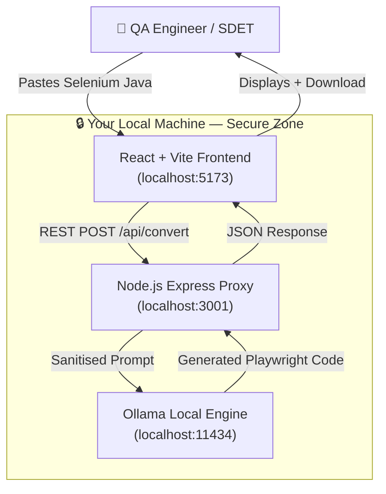

# 🚀 LLM Eval SDET — Selenium to Playwright AI Converter

> **AI-powered, privacy-first migration tool** that converts legacy Selenium Java tests into modern Playwright (TypeScript / JavaScript / Python) using a **locally running LLM (Ollama + CodeLlama)**. Your proprietary code **never leaves your machine**.

[](https://nodejs.org)
[](https://ollama.com)
[](https://vitejs.dev)
[](https://react.dev)
[](LICENSE)

---

## 🏗️ Architecture



---

## ✨ Features

| Feature | Details |
|---|---|
| 🔐 **100% Local** | Runs entirely on your machine — no cloud, no API keys, no data leaks |
| 🤖 **Multi-Model** | Works with any Ollama model (codellama, deepseek-coder, qwen2.5-coder…) |
| 🌐 **Multi-Language** | Converts to Playwright **TypeScript**, **JavaScript**, or **Python** |
| 📖 **Code Explainer** | Extra tab to explain what your Selenium test does (great for docs) |
| 📊 **Stats Panel** | Shows input/output line counts and LLM processing time |
| 💾 **Download** | One-click download of the converted `.ts` / `.js` / `.py` file |
| 🎨 **Premium UI** | Dark glassmorphism design with smooth animations |

### Conversion Rules Applied by the LLM
- `driver.findElement(By.id("x"))` → `page.locator("#x")`
- `driver.findElement(By.xpath("..."))` → `page.locator("xpath=...")`
- `Thread.sleep(2000)` → `await page.waitForTimeout(2000)` *(or removed with auto-waiting)*
- `element.sendKeys("text")` → `await locator.fill("text")`
- `element.click()` → `await locator.click()`
- `@BeforeMethod` / `@AfterMethod` → `test.beforeEach` / `test.afterEach`
- TestNG assertions → Playwright `expect()` assertions

---

## 🛠️ Prerequisites

### 1. Node.js (v18+)
```bash
node --version  # should be >= 18
```

### 2. Ollama
1. Download from [https://ollama.com](https://ollama.com)
2. Pull the CodeLlama model:
   ```bash
   ollama pull codellama
   # OR for a smaller/faster model:
   ollama pull deepseek-coder:6.7b
   # OR for best quality:
   ollama pull qwen2.5-coder:14b
   ```
3. Verify Ollama is running:
   ```bash
   curl http://localhost:11434
   # Should return: "Ollama is running"
   ```

---

## 🚀 Quick Start

### 1. Clone & Install

```bash
# Clone the repo
git clone https://github.com/YOUR_USERNAME/LLM_Eval_SDET.git
cd LLM_Eval_SDET

# Install all dependencies (root + UI)
npm run setup
```

### 2. Start Ollama
```bash
ollama serve   # if not already running as a service
```

### 3. Run the App

```bash
# Start both the backend proxy AND the Vite frontend simultaneously
npm run dev
```

| Service | URL |
|---|---|
| Frontend | [http://localhost:5173](http://localhost:5173) |
| Backend API | [http://localhost:3001](http://localhost:3001) |
| Health Check | [http://localhost:3001/health](http://localhost:3001/health) |

---

## 📁 Project Structure

```
LLM_Eval_SDET/
├── server.js              # Express proxy server (Node.js)
├── package.json           # Root: scripts to run both services
├── .gitignore
│
├── tools/
│   └── test_ollama.js     # Diagnostic: tests Ollama connectivity & inference
│
└── ui/                    # React + Vite frontend
    ├── index.html
    ├── vite.config.ts      # Proxy /api → localhost:3001
    ├── tsconfig*.json
    ├── package.json
    └── src/
        ├── main.tsx        # React entry point
        ├── App.tsx         # Main converter component
        ├── App.css         # Component styles
        └── index.css       # Global design system (glassmorphism)
```

---

## 🔌 API Reference

### `GET /health`
Check if Ollama is reachable.

**Response (200):**
```json
{ "status": "ok", "ollama": "connected" }
```

### `GET /api/models`
List all Ollama models available locally.

**Response:**
```json
{ "models": ["codellama", "deepseek-coder:6.7b"] }
```

### `POST /api/convert`
Convert Selenium Java code to Playwright.

**Request Body:**
```json
{
  "inputCode": "// Selenium Java code...",
  "model": "codellama",
  "language": "typescript"
}
```

**Response:**
```json
{
  "success": true,
  "convertedCode": "// Playwright TypeScript...",
  "model": "codellama",
  "language": "typescript",
  "stats": {
    "inputLines": 45,
    "outputLines": 38,
    "processingTime": "23.5s"
  }
}
```

### `POST /api/explain`
Get a natural-language explanation of Selenium code.

**Request Body:**
```json
{ "code": "// Selenium Java code...", "model": "codellama" }
```

---

## 🔧 Configuration

You can configure via environment variables:

| Variable | Default | Description |
|---|---|---|
| `PORT` | `3001` | Express server port |
| `OLLAMA_URL` | `http://127.0.0.1:11434` | Ollama API endpoint |
| `MODEL` | `codellama` | Default LLM model (test_ollama.js) |

Example:
```bash
PORT=4000 OLLAMA_URL=http://192.168.1.5:11434 npm start
```

---

## 🧪 Diagnostics

Run the Ollama smoke test to verify your setup:

```bash
npm run test:ollama
```

Expected output:
```
🔍 LLM Eval SDET — Ollama Connectivity Test

  Ollama URL : http://127.0.0.1:11434
  Model      : codellama

✅ [1/3] Ollama is reachable
✅ [2/3] Available models: codellama, deepseek-coder:6.7b
⏳ [3/3] Running quick inference with codellama...
✅ [3/3] Inference OK (18.45s)

   Input  : driver.findElement(By.id("username")).sendKeys("admin");
   Output : await page.locator('#username').fill('admin');

🎉 All checks complete!
```

---

## 🤝 Contributing

1. Fork the repo
2. Create your feature branch: `git checkout -b feature/amazing-feature`
3. Commit your changes: `git commit -m 'Add amazing feature'`
4. Push: `git push origin feature/amazing-feature`
5. Open a Pull Request

---

## 📚 Part of AITesterBlueprint Series

This project is **Project 03** in the [AITesterBlueprint](https://github.com/PramodDutta/AITesterBlueprint) series — a collection of real-world AI + testing projects for SDETs and QA Engineers.

| # | Project | Description |
|---|---|---|
| 01 | LLM Eval Basic | Basic LLM evaluation for test generation |
| 02 | Selenium2PlaywrightLocalLLM | Original Selenium→Playwright converter |
| 03 | **LLM Eval SDET** | **This project** — Enhanced multi-language converter |

---

## 📄 License

MIT © [Pramod Dutta](https://github.com/PramodDutta)
